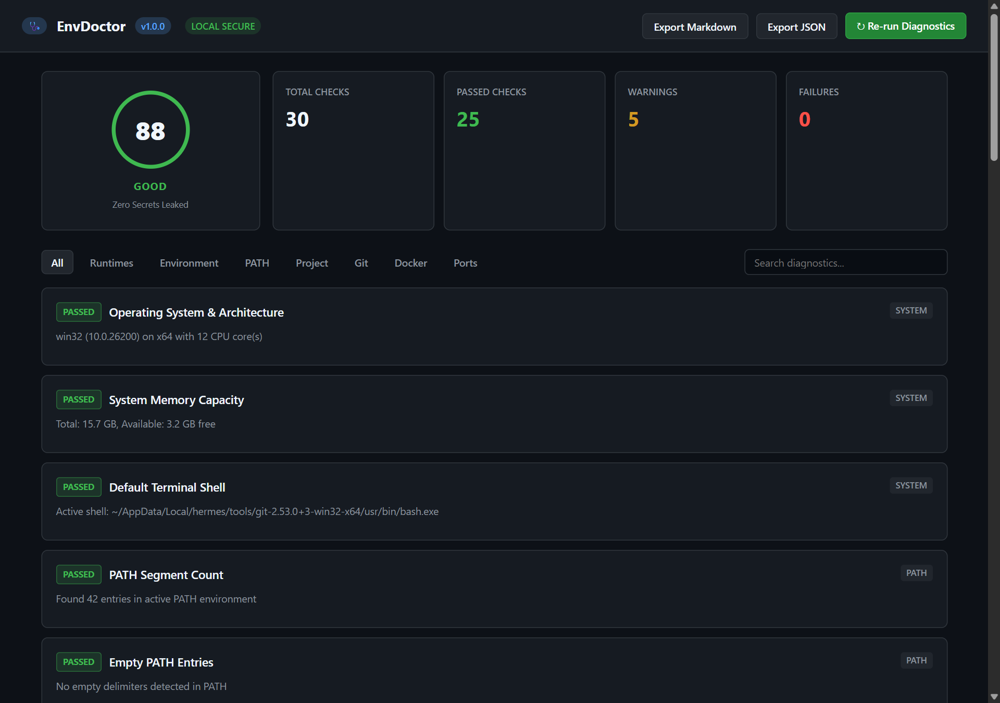
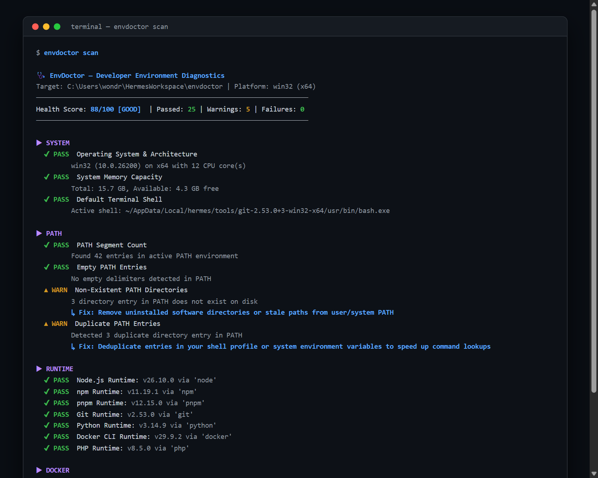
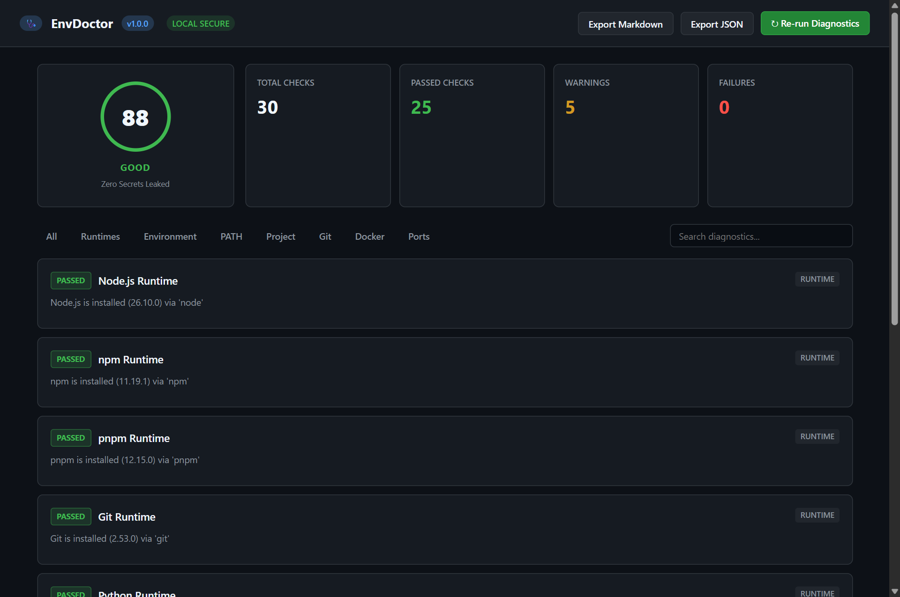
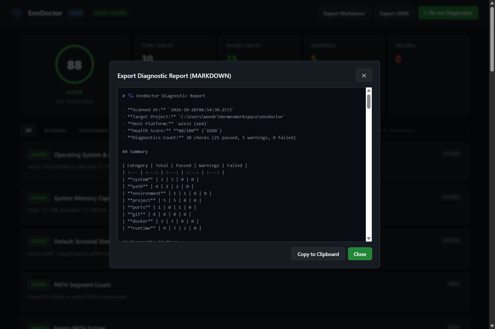

# EnvDoctor

<p align="center">
  <strong>Developer environment configuration checker, diagnostics runner, and remediation engine.</strong>
</p>

<p align="center">
  
  
  
  
  
</p>

<p align="center">
  
</p>

---

## Visual Showcase

<div align="center">

### CLI Terminal Diagnostics Scan


<br/><br/>

### Category Filtering & Runtime Diagnostics


<br/><br/>

### Sanitized Report Export Preview (Markdown / JSON)


</div>

---

## Repository Details

- **GitHub Repository:** [`https://github.com/0xyz-exe/envdoctor`](https://github.com/0xyz-exe/envdoctor)
- **Maintainer:** `0xyz-exe`
- **License:** Apache License 2.0
- **Default Branch:** `main`

---

## Overview

**EnvDoctor** inspects your workstation and project environment to identify missing runtimes, incompatible tool versions, broken PATH variables, misconfigured `.env` variables, port conflicts, package manager mismatches, and subtle OS quirks before they disrupt your development workflow.

### Core Principles

1. **Local-First:** Performs all checks on your machine without external cloud dependencies.
2. **Zero Secret Leakage:** Automatically recognizes and redacts API keys, bearer tokens, AWS credentials, JWTs, and database passwords from reports.
3. **Safe Subprocess Execution:** Strict executable allowlist with argument arrays; no arbitrary shell evaluation or dangerous system modifications.
4. **Actionable Remediation:** Every finding includes the root cause, expected configuration, actual detected state, and concrete fix commands.
5. **Multi-Interface:** Run via command-line, export machine-readable JSON/Markdown, or launch the interactive browser dashboard.

---

## Features

- **System Diagnostics:** Inspects OS release, 64-bit CPU architecture, core counts, memory thresholds (warns if free memory < 1GB), and active default shell.
- **Runtime Checker:** Safely checks Node.js, npm, pnpm, Git, Python, Docker CLI, PHP, Go, and Cargo. Handles platform-specific execution differences (such as Windows `.cmd` wrappers) transparently.
- **PATH Environment Validator:** Detects empty delimiters (`;;` or `::`), non-existent directories, duplicate entries, and stale uninstalled software paths.
- **Environment Parity Inspector:** Compares `.env` against templates (`.env.example`, `.env.sample`, `.env.template`). Flags missing variables and empty required values while keeping secret values safely redacted.
- **Project Configuration Inspector:** Detects project stack (Node.js, Python, PHP, Rust, Go, Docker), validates manifest JSON syntax, checks `.gitignore`, and warns on conflicting lockfiles (`package-lock.json` + `pnpm-lock.yaml` + `yarn.lock`).
- **Git State & Identity:** Verifies Git binary availability, author configuration (`user.name`, `user.email`), active branch, detached HEAD state, and untracked changes.
- **Docker Diagnostics:** Differentiates between missing Docker CLI, active daemon, and unreachable daemon service.
- **Port Conflict Scanner:** Performs non-blocking TCP socket probes on common ports (3000, 5173, 8000, 8080, 5432, 3306) or custom user ports.
- **Interactive Web Dashboard:** Zero-dependency embedded local HTTP server serving a developer console with health scoring, search, category filtering, and instant JSON/Markdown report exports.

---

## Quick Start

### 1. Installation

```bash
# Clone the repository
git clone https://github.com/0xyz-exe/envdoctor.git
cd envdoctor

# Install dependencies and build
pnpm install
pnpm run build
```

### 2. Run Diagnostics

```bash
# Full environment scan in terminal
node dist/cli.js scan

# Launch interactive web dashboard
node dist/cli.js ui --port 4173
```

---

## CLI Usage & Reference

```text
🩺 EnvDoctor — Developer Environment Configuration Checker

USAGE:
  envdoctor <command> [options]

COMMANDS:
  scan                  Run comprehensive environment diagnostics (default)
  doctor                Full diagnostic scan with health evaluation
  check <tool>          Quick check for a specific tool (e.g., node, python, docker)
  ui, web               Launch the local interactive web dashboard
  report                Generate and print diagnostic report (table, json, or markdown)

OPTIONS:
  --project, -p <dir>   Target project directory (default: current directory)
  --category, -c <cat>  Filter by category (system, runtime, path, environment, project, git, docker, ports)
  --format, -f <fmt>    Output format: table (default), json, markdown
  --port <num>          Port to check or UI server port
  --strict              Treat warnings as failures (exit code 1)
  --timeout <ms>        Per-plugin execution timeout (default: 5000ms)
  --no-color            Disable terminal ANSI color codes
  --version, -v         Display current version
  --help, -h            Show this help reference
```

### Examples

```bash
# Scan a specific repository in strict mode
envdoctor scan --project /path/to/my-repo --strict

# Output machine-readable JSON for CI pipelines
envdoctor scan --format json

# Export clean GitHub Markdown report
envdoctor scan --format markdown > env-report.md

# Check only runtime dependencies
envdoctor scan --category runtime

# Launch local dashboard on custom port
envdoctor ui --port 3050
```

---

## Exit Codes

| Code | Meaning |
| :---: | :--- |
| `0` | Scan completed successfully with no failures (or warnings in non-strict mode). |
| `1` | One or more diagnostic checks failed (or warning detected under `--strict`). |
| `2` | Invalid CLI arguments or target directory does not exist. |
| `3` | Internal execution error or unexpected process crash. |

---

## Security Model

- **Pattern-Based Redaction:** Scans all configuration and output for sensitive keys (`API_KEY`, `TOKEN`, `PASSWORD`, `SECRET`, `DATABASE_URL`) and credential patterns (`sk-`, `ghp_`, `AKIA`, `Bearer`).
- **No Arbitrary Shelling:** Uses direct process execution (`execFile`) with fixed allowlists rather than invoking arbitrary shell strings.
- **Non-Destructive:** Performs read-only inspections. EnvDoctor will never modify PATH, delete lockfiles, or terminate running processes automatically.

---

## Testing

EnvDoctor includes unit and integration tests powered by Vitest:

```bash
# Run all tests
pnpm test

# Run TypeScript type check
pnpm run typecheck

# Build distributable bundle
pnpm run build
```

---

## License

EnvDoctor is open-source software licensed under the [Apache License 2.0](LICENSE).
